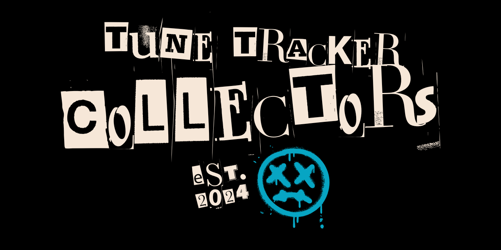

# Collectors' Tune Tracker (CTT)

**The crate-digger's logbook.** Catalog every record, CD, tape, poster, and ticket stub you own — photograph it,
grade it, value it — then follow the people, labels, and pressings that connect one piece of music to the next.

> 🚧 **Re-platforming in progress (Nov 2026).** This repo is being rebuilt from the spec in [`docs/spec`](docs/spec).
> The old Create-React-App prototype in `src/` is slated for removal, and the former
> `collectorstunetracker_db` repo now lives in [`legacy/database`](legacy/database) for reference.

## Specification

| Doc | What's in it |
|---|---|
| [01 — Product Spec](docs/spec/01-product-spec.md) | Vision, personas, formats & collection kinds, features, images, NFRs |
| [02 — Brand & Design](docs/spec/02-brand-and-design.md) | Marks, palette, type, components, motion, voice, accessibility |
| [03 — Domain & Data Model](docs/spec/03-domain-and-data-model.md) | Catalog vs. copy, entities, RLS tenancy, legacy mapping |
| [04 — Architecture](docs/spec/04-architecture.md) | AWS + Substratal Apps platform, auth, DB, image pipeline, repo layout |
| [05 — Build Plan](docs/spec/05-build-plan.md) | Audit of what exists, consolidation steps, phased roadmap |
| [06 — Open Questions](docs/spec/06-open-questions.md) | Decisions pending, with working assumptions |

## Stack (target)

React 19 + Vite PWA · Go on AWS Lambda (arm64) · API Gateway HTTP API · Aurora Serverless v2 PostgreSQL (Data API, RLS) ·
S3 + CloudFront media pipeline · Terraform · identity, orgs & roles via the **Substratal Apps** platform.

## Brand

Logo system lives in [`brand/logo`](brand/logo) — zine wordmark, sleeve badge, and CTT block in
charcoal `#1C191A`, cream `#F6E7D8`, teal `#07A5C3`, signal `#F14902`, and mustard `#F4B324`.

## Links

* [GitHub Pages site](https://adron.github.io/collectorstunetracker/) (from the `collectors_tracker_docs` branch)
* [Automated lookups / CDDB discussion — issue #4](https://github.com/Adron/collectorstunetracker/issues/4)

*Est. 2024.*
