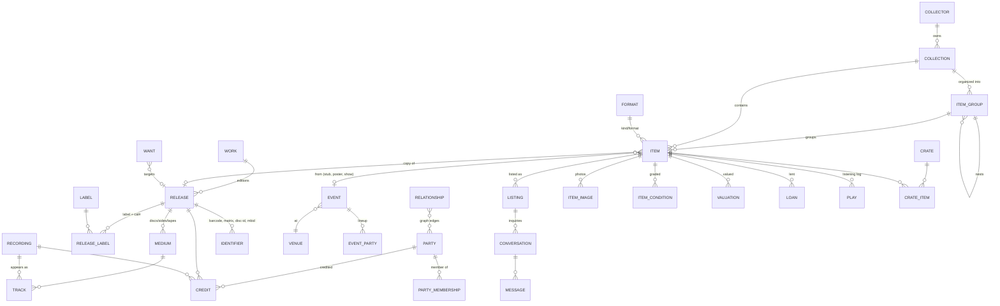

# 03 — Domain & Data Model

> Status: **Draft v0.2** · 2026-11-12 · Engine: **PostgreSQL 16+**. Hosted on **Neon** (its own project, so fully
> autonomous) for the Vercel build; the same schema runs unchanged on Aurora for the AWS path. See
> [04 — Architecture](04-architecture.md) and [08 — Hosting, Costs & Scaling](08-hosting-costs-and-scaling.md).

## 1. Core idea: catalog vs. copy

Collectors care about **three levels** that most apps blur together:

```
Work  (the album as an idea — "Kind of Blue")
 └── Release  (a specific edition/pressing — Columbia CL 1355, 1959 US mono, 6-eye label)
      └── Item  (YOUR copy — VG+/VG, bought at Amoeba 2019, shelf B3, slot 12, 6 photos)
```

- **Work** and **Release** live in the **shared catalog** — global, de-duplicated, sourced from MusicBrainz/Discogs and user contributions.
- **Item** lives in a **user's collection** — private by default, owned by a Substratal user (or org).
- An Item may exist **without** a Release (bootleg, demo, homemade, not-yet-identified) and be linked later.
- Memorabilia, print, merch, gear, and show history are Items with a different `kind`; they link to the
  catalog through **Events**, **Parties** (people/groups), and **Releases** rather than being a Release.

## 2. Bounded contexts

| Context | Owns | Tenancy |
|---|---|---|
| **Identity & Access** | Users, orgs, roles, permissions, sessions | **Substratal platform** — CTT stores none of it |
| **Catalog** | Parties, works, releases, media, tracks, credits, labels, identifiers, events, venues, relationships | Global (shared), edits moderated |
| **Collection** | Collector profile, collections, groups, items, visibility, conditions, locations, provenance, valuations, loans, crates, wants, listening log, tags | Per owner (RLS) |
| **Market** | Listings, conversations, messages, reports | Listings public by design; messages private to the two parties |
| **Media** | Images & renditions | Per owner; renditions inherit collection visibility |
| **Ingest** | Import jobs, external-source mappings, lookup cache | Per owner (jobs) / global (cache) |

## 3. Entity overview



## 4. Catalog context (shared)

| Table | Key columns | Notes |
|---|---|---|
| `party` | `id`, `type` (person/group/orchestra/choir/other), `name`, `sort_name`, `disambiguation`, `begin_date`, `end_date`, `country`, `bio_md` | Artists, musicians, writers, producers, engineers, designers — all one table |
| `party_alias` | `party_id`, `name`, `locale`, `kind` | Search aliases, ANVs ("as credited") |
| `party_membership` | `group_id`, `member_id`, `instruments[]`, `begin`, `end` | Band lineups over time |
| `label` | `id`, `name`, `parent_label_id`, `country`, `founded`, `defunct` | Imprints nest under parents |
| `work` | `id`, `title`, `primary_type` (album/single/EP/compilation/live/soundtrack/other), `first_release_date`, `artist_credit` | ≈ MusicBrainz release-group / Discogs master |
| `release` | `id`, `work_id`, `title`, `artist_credit`, `release_date`, `country`, `status` (official/promo/bootleg/test), `packaging`, `format_summary`, `notes_md` | One row per edition/pressing/variant |
| `release_label` | `release_id`, `label_id`, `catalog_number` | Multiple labels/cat#s per release |
| `medium` | `release_id`, `position`, `format_code`, `title`, `attributes jsonb` | A disc, an LP, a cassette; `attributes` holds RPM, color, weight, NR type… validated against `format.attribute_schema` |
| `recording` | `id`, `title`, `length_ms`, `isrc[]` | A recorded performance |
| `track` | `medium_id`, `position` (A1, B2, 1-03), `recording_id`, `title_override`, `length_ms` | |
| `credit` | `party_id`, `target_type` (release/recording/work), `target_id`, `role`, `role_detail`, `credited_as` | Role vocabulary: performer, vocals, guitar…, writer, composer, lyricist, producer, engineer, mixing, mastering, lacquer cut, artwork, photography, liner notes |
| `identifier` | `target_type`, `target_id`, `scheme`, `value`, `side` | Schemes: `barcode`, `matrix_runout`, `disc_id_mb`, `disc_id_cddb`, `ifpi_mould`, `ifpi_mastering`, `isrc`, `mbid`, `discogs_id`, `asin`; `value` stored normalized + raw |
| `venue` | `id`, `name`, `city`, `country`, `geo` (point, optional) | |
| `event` | `id`, `type` (concert/festival/session/release/tour/other), `name`, `start_date`, `end_date`, `venue_id`, `tour_id` | |
| `event_party` | `event_id`, `party_id`, `billing_order`, `role` | Lineups |
| `setlist_entry` | `event_id`, `position`, `recording_id?`, `title` | |
| `relationship` | `from_type`, `from_id`, `to_type`, `to_id`, `kind`, `begin`, `end`, `source` | Generic graph edges: influenced-by, collaborated, sampled, cover-of, remix-of, signed-to, recorded-at |
| `catalog_image` | `target_type`, `target_id`, `source` (cover_art_archive/user_contributed), `s3_key`, `license` | Fallback art; never user originals |
| `external_ref` | `local_type`, `local_id`, `source`, `source_id`, `last_synced_at`, `payload_hash` | Idempotent sync with MusicBrainz/Discogs/gnudb |
| `catalog_edit` | `id`, `submitted_by_sub`, `target`, `patch jsonb`, `status`, `reviewed_by_sub` | Moderated user contributions (v2 trust levels) |

> **Catalog size on Neon Free:** Neon's free plan allows 1 GB per project, and a full MusicBrainz mirror is tens of GB.
> So the catalog is **lazy**: a release, its tracks, and its credits are copied into `catalog` only when some user adds
> it or looks at it closely. Everything else is a live, cached lookup (`lookup_cache`). A full mirror becomes possible on a
> paid plan or on the AWS path.

## 5. Collection context (per owner)

Every row carries `owner_sub` (the Substratal user `sub`) and optional `owner_org_id`. **No users table** —
the Substratal platform is the source of truth for identity; CTT never stores passwords or emails.

| Table | Key columns | Notes |
|---|---|---|
| `collector` | `sub` (PK), `handle` (unique, `@handle`), `display_name`, `bio_md`, `avatar_image_id`, `profile_visibility` (private/public), `search_indexing` (bool), `show_values` (bool), `default_currency`, `created_at` | App-specific profile only. Identity (email, password, MFA) stays in Substratal. |
| `collection` | `id`, `owner_sub`, `owner_org_id`, `name`, `slug`, `description`, `accent` (accent/hot/warm), `visibility` (private/unlisted/public), `unlisted_token`, `show_values`, `cover_image_id`, `sort_order`, `archived_at` | |
| `item_group` | `id`, `collection_id`, `owner_sub`, `parent_group_id?`, `name`, `slug`, `description`, `visibility` (inherit/private/unlisted/public), `unlisted_token`, `sort_order`, `archived_at`, `path` (ltree or materialized `id` path) | Nested groups inside a collection. `path` makes "everything under this group" one indexed query. |
| `format` | `code` (PK, e.g. `vinyl_lp`, `vinyl_7`, `cd`, `sacd`, `cassette`, `reel`, `minidisc`, `dat`, `digital`, `shellac_78`, `memorabilia_poster`, `ticket_stub`, `print_zine`, `apparel`, `gear_turntable`…), `family`, `kind`, `label`, `attribute_schema jsonb`, `icon` | Reference data — adding a format = inserting a row |
| `item` | `id`, `collection_id`, `group_id?`, `visibility` (inherit/private/unlisted/public), `unlisted_token`, `effective_visibility` (maintained, see §9.1), `owner_sub`, `kind` (media/memorabilia/print/apparel/gear/experience), `format_code`, `release_id?`, `event_id?`, `title`, `artist_display`, `attributes jsonb`, `status` (owned/ordered/lent/for_sale/sold/traded), `location_id?`, `rating`, `public_notes_md`, `private_notes_md`, `is_unofficial`, `acquired_on`, `acquired_from`, `price_paid` (numeric), `price_currency`, `primary_image_id`, `search_tsv` | `attributes` holds format-specific + copy-specific detail (e.g. *this* copy's runout if it differs, "n of 500" number) |
| `item_condition` | `item_id`, `part` (media/sleeve/packaging/obi/insert/disc_n), `grade` (enum M, NM, VG_PLUS, VG, G_PLUS, G, F, P), `notes`, `graded_at` | History kept — regrade adds a row |
| `location` | `id`, `owner_sub`, `name`, `parent_id`, `kind` (room/shelf/crate/box/slot) | Tree: Living Room › Kallax B › Row 3 |
| `valuation` | `item_id`, `amount`, `currency`, `source` (manual/discogs/other), `as_of` | |
| `loan` | `item_id`, `borrower_name`, `borrower_sub?`, `lent_on`, `due_on`, `returned_on` | |
| `play` | `item_id`, `played_at`, `gear_item_id?`, `notes` | Listening log |
| `tag` / `item_tag` | `owner_sub`, `name` / `item_id`, `tag_id` | |
| `crate` / `crate_item` | `id`, `owner_sub`, `name`, `description`, `accent`, `visibility` / `crate_id`, `item_id`, `position` | User lists across collections |
| `want` | `id`, `owner_sub`, `release_id?`, `work_id?`, `free_text`, `max_price`, `currency`, `priority`, `notes`, `fulfilled_item_id?` | |
| `signature` | `item_id`, `party_id`, `signed_on?`, `authenticated_by`, `coa_image_id?` | Signed memorabilia/records |

### 5.1 Marketplace (listings & messages)

| Table | Key columns | Notes |
|---|---|---|
| `listing` | `id`, `item_id`, `seller_sub`, `type` (sale/trade/sale_or_trade), `status` (draft/active/pending/sold/traded/withdrawn), `price`, `currency`, `accepts_offers`, `trade_for_md`, `trade_want_ids[]`, `ships_to[]` (ISO countries), `local_pickup`, `shipping_notes_md`, `snapshot jsonb`, `image_ids[]`, `expires_at`, `published_at`, `closed_at` | `snapshot` freezes the public fields at publish time (title, release, pressing, grades), so the listing never leaks private fields and stays stable if the item is edited. Republishing refreshes it. |
| `conversation` | `id`, `listing_id?`, `buyer_sub`, `seller_sub`, `status`, `last_message_at` | One thread per buyer per listing |
| `message` | `id`, `conversation_id`, `sender_sub`, `body_md`, `created_at`, `read_at` | Rate-limited; notifications via Substratal |
| `report` | `id`, `reporter_sub`, `target_type` (listing/message/profile), `target_id`, `reason`, `status`, `resolved_by_sub` | Moderation queue |

Constraint: a `sale` or `sale_or_trade` listing can't be activated for an item with `is_unofficial = true`.

## 6. Media context

| Table | Key columns | Notes |
|---|---|---|
| `item_image` | `id`, `item_id`, `owner_sub`, `type` (front_cover, back_cover, spine, gatefold_inside, label_side, runout_side, disc, obi, insert, hype_sticker, booklet_page, j_card, shell, box, damage, receipt, signature, coa, other), `side` (A/B/C…), `position`, `status` (pending/processing/ready/failed), `original_key`, `width`, `height`, `bytes`, `content_type`, `sha256`, `phash`, `dominant_color`, `alt_text`, `ocr_text?`, `created_at` | `original_key` is private; renditions are derived by convention |
| `image_rendition` | `image_id`, `variant` (thumb_200/card_600/detail_1600), `format` (avif/webp/jpeg), `key`, `width`, `height`, `bytes` | Could be implicit by key convention; table kept for cache-busting & audits |

S3 key convention: `u/{owner_sub}/i/{item_id}/{image_id}/original` and `…/{variant}.{format}`.

## 7. Ingest context

| Table | Notes |
|---|---|
| `import_job` | `id`, `owner_sub`, `source` (discogs_csv/generic_csv/json/musicbrainz_collection), `status`, `s3_key`, `mapping jsonb`, `stats jsonb`, `dry_run`, timestamps |
| `import_row` | `job_id`, `row_num`, `raw jsonb`, `match_status` (matched/ambiguous/unmatched/error), `release_id?`, `item_id?`, `message` |
| `lookup_cache` | `source`, `key`, `response jsonb`, `fetched_at`, `ttl` — respects MusicBrainz 1 req/s and Discogs rate limits |

## 8. Cross-cutting conventions
- IDs: **UUIDv7** (time-ordered — better index locality than the legacy `uuid_generate_v4()`), exposed in the API with type prefixes (`itm_…`, `col_…`, `rel_…`) like Substratal's `app_…` style.
- Timestamps: `created_at`, `updated_at` as `timestamptz` (legacy used `timestamp` without zone — fixed).
- Soft delete via `deleted_at` on user-owned tables; hard purge job honors Substratal erasure requests.
- Text: all `text`, Unicode NFC normalized; `sort_name` for artist sorting ("Beatles, The").
- Search: Postgres `tsvector` + `pg_trgm` for fuzzy matching in v1; an OpenSearch Serverless index is a v2 option if needed.
- Money: `numeric(12,2)` + ISO-4217 currency code.

## 9. Tenancy, visibility & security (Row-Level Security)

### 9.1 Effective visibility

`effective_visibility` on `item` (and on `item_group`) is **stored and maintained**, not computed on every read, so
public pages and the market are plain indexed queries:

```
effective(item) =
  'private'                           if collector.profile_visibility = 'private'
  first non-'inherit' value of        item → group → parent groups … → collection
```

- When a collection, group, or profile visibility changes, one statement recomputes every descendant using the
  group `path` (`WHERE path <@ :group_path`). It's done in the same transaction as the change, so there's never a
  window where something private is shown.
- Read rules: owner sees everything. Anyone sees `public`. Anyone holding the right `unlisted_token` for the item,
  or for one of its ancestors, sees `unlisted`.
- Field-level privacy is enforced in the **read model**, not just the UI: public queries select from
  `public_item_v`, a view that never includes `price_paid`, `acquired_from`, `location_id`, `private_notes_md`,
  loans, valuations (unless `show_values`), or private image types.
- Listings are read from `listing.snapshot`, never by joining to the private item.

### 9.2 Database layout & RLS

- Everything lives in CTT's own Postgres database (a dedicated **Neon project** on Vercel, or a `ctt` database
  on Aurora for the AWS path), split into schemas by bounded context: `catalog`, `collection`, `market`, `media`,
  `ingest`, `app`. Roles: `ctt_owner`, `ctt_migrator`, `ctt_api`, `ctt_worker`, `ctt_readonly`.
- Each request runs in a transaction that sets `SET LOCAL ctt.sub = '<jwt sub>'` and `ctt.org = '<org_id>'`.
- RLS policies on all collection/media/ingest tables:
  `USING (owner_sub = current_setting('ctt.sub') OR (visibility <> 'private' AND <read-only path>))`.
- Catalog tables are readable by all; writes only via the moderation path (`catalog_edit`) or the ingest worker role.
- RLS is defense in depth: the app's own authorization checks come first. On Neon, the `SET LOCAL` runs inside each
  transaction through the Neon serverless driver.
- Nothing in CTT's database references Substratal's data. All identity data comes through the Substratal API and tokens.

## 10. Legacy schema → new model

| Legacy (`collectorstunetracker_db` / skeleton branch) | Fate |
|---|---|
| `the_system.tenants` | **Replaced** by Substratal organizations/tenants |
| `the_system.users` (plaintext seed password `changeThis!`) | **Dropped** — identity moves to Substratal; no passwords ever stored in CTT |
| `the_system.roles` (`can_add/can_edit/can_delete`) | **Replaced** by Substratal app roles + permissions: `app.collectors-tune-tracker.collection.read`, `app.collectors-tune-tracker.collection.write`, `app.collectors-tune-tracker.collection.delete`, `app.collectors-tune-tracker.catalog.edit`, `app.collectors-tune-tracker.catalog.moderate`, `app.collectors-tune-tracker.admin` |
| `the_system.user_roles` | **Replaced** by Substratal `/users/{id}/roles` |
| `the_collections` schema (empty) | **Becomes** the `ctt` database with the schemas above |
| `notes` / `message` columns on every table | Dropped as a convention; per-entity `notes_md` where it's meaningful |

The legacy schema holds only a seed root account (no collection data), so this is assumed to be a design
migration with no data migration — to confirm (Q2 in [06](06-open-questions.md)).
The legacy SQL is preserved for reference under [`/legacy/database`](../../legacy/database).
