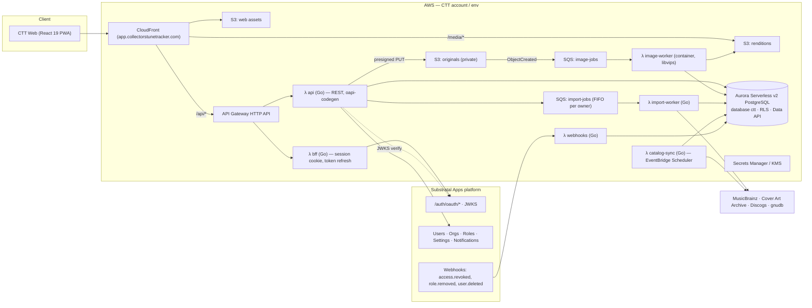

# 04 — Architecture: AWS + Substratal Apps

> Status: **Draft v0.1** · 2026-11-09 · Principle: **build CTT the way the Substratal platform builds itself**
> (Go on arm64 Lambda, Terraform, Aurora PostgreSQL via the Data API, S3 + CloudFront, no VPC/NAT at
> the starting tier) so the two share tooling, operations, and cost profile.
>
> **CTT is a standalone app and a *customer* of Substratal.** It may share some AWS resources (e.g. the
> Aurora cluster), but it integrates with Substratal **only through the public API**, exactly as an
> outside company adding its app would: self-registered under a dedicated managing account, hosted OAuth,
> webhooks, and API keys. No staff shortcuts, no reading Substratal's database, no embedded login.
> See §3.1.

## 1. Division of responsibility

| Concern | Substratal Apps platform (`api.substratalapps.com`) | CTT (this repo) |
|---|---|---|
| Sign-up, login, MFA/passkeys, SSO, password reset | ✅ Hosted OAuth 2.0 + PKCE | Redirects to it; never sees passwords |
| Users, orgs/tenants, roles, permissions, entitlements | ✅ `app_ctt` registration, `app.ctt.*` permissions | Enforces permissions from token claims |
| Per-app user prefs (theme, default view, units) | ✅ `/users/{id}/apps/app_ctt/settings` (schema-validated) + AppProfile (≤16 KB JSON) | Reads/writes via API |
| Push & in-app notifications | ✅ `/applications/{id}/push-credentials`, `/users/{id}/notifications` | Emits events (loan due, want found, import done) |
| Audit, data export/erasure requests | ✅ Platform audit + erasure webhooks | Honors erasure for CTT data; provides CTT export |
| **Catalog, collections, items** | — | ✅ Own Postgres schema |
| **Images / media storage** | — (platform S3 is only avatars/app icons) | ✅ Own S3 + CloudFront + processing |
| **Search, imports, external catalog sync** | — | ✅ |
| **Billing for CTT plans** (if any) | — (platform billing covers its own plans only) | ✅ Own Stripe integration *if* CTT charges (Q4) |

## 2. System diagram



## 3. Auth & access flow

### 3.1 Onboarding CTT as a Substratal customer

| Step | What | Notes |
|---|---|---|
| 1 | Create a dedicated **managing account** on Substratal via normal sign-up (`admin-ctt@thrashingcode.com`), verify email, enable MFA/passkey | Not a staff account and not anyone's personal login; credentials in a team password manager. Owns everything below. |
| 2 | Create an **organization** "Collectors' Tune Tracker" owned by that account | Lets more maintainers be added later as org members without sharing the login. |
| 3 | `POST /applications` → **`app_ctt`** (self-registered, starts `pending_review`) with permissions `app.ctt.collection.{read,write,delete}`, `app.ctt.catalog.{edit,moderate}`, `app.ctt.admin` and roles `role_ctt_collector` (default), `role_ctt_curator`, `role_ctt_admin`; icon from `/brand/logo` | Done by hand from [setup-on-substratal.md](../setup-on-substratal.md), as the managing account. No staff or concierge path. |
| 4 | Wait for Substratal review → approved | Same queue any customer goes through. |
| 5 | Register OAuth redirect URIs per env, webhook endpoint + subscriptions (`access.revoked`, `role.removed`, erasure), push credentials (later) | Webhook signing secret → Secrets Manager. |
| 6 | Create a server-to-server **API key** scoped to `app_ctt` | Stored in Secrets Manager; rotated on a schedule. |
| 7 | Declare the `settings_schema` for CTT user settings (theme, default view, currency, units) | |

Separate `dev` and `prod` registrations (`app_ctt-dev`, `app_ctt`; slugs can't contain `_`) keep test users and keys apart.

### 3.2 Request flow

1. Browser → **BFF** `/api/auth/login` → redirect to Substratal hosted login (**authorization code + PKCE**).
   As a self-registered customer app this is the only option (embedded login is staff-only), and it gives
   MFA/passkeys/SSO for free.
3. BFF exchanges the code at `/auth/oauth/token`, stores the refresh token **only** in an
   `HttpOnly; Secure; SameSite=Lax` cookie (same pattern as the Substratal Hub's Go BFF), and hands the SPA
   a short-lived **app token** (5-min JWT, `aud=app_ctt`).
4. **API** verifies the JWT locally against `/.well-known/jwks.json` (cached), reads `sub`, `org_id`,
   `entitlement_status`, `effective_permissions`, then opens a DB transaction with
   `SET LOCAL ctt.sub/ctt.org` so Postgres RLS enforces ownership (defense in depth).
5. **Revocation (required by the platform):** the `webhooks` Lambda subscribes to `access.revoked` and
   `role.removed`, verifies the signature, and kills matching BFF sessions immediately. `user.deleted` webhooks
   trigger a purge job for that `sub` (rows + S3 prefix `u/{sub}/`).
6. Server-to-server calls (e.g. sending notifications) use a Substratal **API key** scoped to `app_ctt`
   from Secrets Manager, with `Idempotency-Key` on POSTs.

## 4. Database

**Decision (Q1, refined): Aurora Serverless v2 PostgreSQL. CTT gets its own `ctt` database inside the shared
Substratal cluster, reached through the RDS Data API, with RLS on.**

### 4.1 Why Postgres
- The domain is **relational and graph-ish**: works → releases → media → tracks, many-to-many credits,
  relationships, events. "Every release this engineer cut, that I own, on a 1970s pressing" is a join, not a key lookup.
- `pg_trgm` fuzzy matching plus `tsvector` full text cover v1 search without adding another service.
- `jsonb` holds schemaless format attributes (RPM, noise reduction, color variants) without a table per format.
- The Data API means no VPC, no NAT, and no connection pooling to manage from Lambda, which matches the platform.

### 4.2 How CTT stays autonomous: a separate *database*, not just a schema

A schema alone isn't enough. A Postgres **cluster** can hold many **databases**, and a database is the unit
that is truly walled off: a session connected to one database **cannot query another**, even if the SQL names
it, because Postgres has no cross-database joins (short of extensions like `dblink`/`postgres_fdw`, which CTT
never installs). So CTT is split at every level:

```
Aurora cluster (shared infrastructure: compute/ACUs, storage, backups, patching)
├── database "substratal"   ← Substratal platform (incl. its "blog" schema). CTT has no access.
└── database "ctt"          ← everything CTT owns, nothing else
    ├── schema catalog      parties, works, releases, media, tracks, credits, labels, identifiers, events…
    ├── schema collection   collections, items, conditions, locations, loans, plays, crates, wants, tags
    ├── schema media        item_image, image_rendition
    ├── schema ingest       import_job, import_row, external_ref, lookup_cache
    └── schema app          bff sessions, webhook dedupe log, schema_migrations
```

| Layer | Isolation | Enforced by |
|---|---|---|
| **Database** | `CREATE DATABASE ctt OWNER ctt_owner`; `REVOKE CONNECT ON DATABASE ctt FROM PUBLIC`; likewise `REVOKE CONNECT ON DATABASE substratal FROM` every `ctt_*` role | Postgres connection authorization |
| **Roles** | All CTT roles use the `ctt_` prefix: `ctt_owner` (NOLOGIN, owns all objects), `ctt_migrator` (DDL), `ctt_api` (DML under RLS), `ctt_worker` (ingest/image jobs), `ctt_readonly` (support/analytics). None are members of any Substratal role, and none have superuser, `rds_superuser`, or `CREATEROLE`. | Postgres grants |
| **Credentials** | One Secrets Manager secret per CTT role (`ctt/{env}/db/ctt_api`, …). The Data API uses the secret to decide *which DB user* runs a statement, and every call passes `database: "ctt"`. | Secrets Manager + IAM |
| **IAM** | CTT Lambdas may call `rds-data:*` on the cluster ARN **and** read only `ctt/*` secrets. Without a Substratal secret, they can't act as a Substratal DB user. | IAM policy (plus a cross-account role if the cluster lives in the Substratal account; see Q15) |
| **Extensions** | `pg_trgm` and `btree_gin` are installed **in the `ctt` database only** (extensions are per-database). No `dblink`, no `postgres_fdw`. UUIDv7 ids are generated in Go, not by an extension, so any Postgres 15+ works. | Migration review |
| **Code** | Connection config is three env vars: `CTT_DB_CLUSTER_ARN`, `CTT_DB_SECRET_ARN`, `CTT_DB_NAME`. The Go `internal/db` package hides the Data API behind an interface, with a `pgx` implementation for plain Postgres (local dev, CI, and any future host). | Code structure |
| **Terraform** | CTT's Terraform **reads** the cluster as a data source (ARN via tfvars) and creates only CTT's secrets, IAM, and DB bootstrap. It never changes cluster settings, and Substratal's Terraform never references CTT. Separate state files. | Separate stacks |
| **Data flow** | No foreign keys, views, triggers, or jobs cross into `substratal`. User identity arrives only as JWT claims (`sub`, `org_id`) and is stored as plain text ids. | Design rule, checked in code review |

**The only shared touchpoint** is a one-time bootstrap: someone with the cluster's admin credentials runs
`db/bootstrap/0000_ctt_database_and_roles.sql` (create the database and the `ctt_*` roles, set
role passwords from the CTT secrets, apply the revokes above). From then on, CTT's own migrator owns everything inside `ctt`.

### 4.3 Moving CTT to its own Postgres later

Because nothing crosses the database boundary, a move is mechanical:

1. Provision the new Postgres: a dedicated Aurora cluster, RDS, Aurora DSQL if it's compatible by then, or any other host.
2. Run `db/bootstrap` there to create the same roles.
3. Copy the data:
   - **Small/maintenance window:** `pg_dump -Fc -d ctt` → `pg_restore` (roles already exist, ownership carries over).
   - **Near-zero downtime:** logical replication (publication on `ctt`, subscription on the new host), then a short cutover.
4. Point the three env vars at the new host (or switch the `internal/db` driver to `pgx` if it's not Data-API-capable) and redeploy.
5. `DROP DATABASE ctt` on the shared cluster.

**Proof it stays portable:** CI runs every migration and the full integration suite against a **stock
`postgres:17` container**, not Aurora. Anything Aurora-specific that slips into CTT fails the build.

### 4.4 Alternatives considered

| Option | Verdict |
|---|---|
| **A. Own `ctt` database in the shared Substratal cluster** | ✅ **Chosen.** Lowest cost and ops; hard isolation at the database level; the move-out path is above. |
| A′. Only a `ctt` schema inside the `substratal` database (the blog engine's pattern) | ✘ Too coupled: shared search_path, extensions, and `pg_dump` scope, and it invites cross-schema joins. |
| B. Dedicated Aurora Serverless v2 cluster | The move-out target when CTT load, blast radius, or ownership justify it. |
| C. Aurora DSQL | Watch: serverless and Postgres-compatible, but `pg_trgm`, foreign keys, and RLS support need verifying first. |
| D. DynamoDB | ✘ Poor fit for the credit/relationship graph and ad-hoc collector queries. |

Migrations: plain numbered SQL in `/db/migrations`, run as `ctt_migrator` by the `migrate` Lambda in CI. Reference
data (formats, grade scale, credit roles) lives in `/db/seed`.

## 5. Images pipeline

```
SPA ──POST /items/{id}/images {type, side, contentType, bytes}──▶ api
api ──insert item_image(status=pending)──▶ DB
api ──presigned PUT (or multipart for >10 MB)──▶ SPA
SPA ──PUT original──▶ s3://ctt-{env}-originals/u/{sub}/i/{item}/{image}/original
S3 ObjectCreated ─▶ SQS image-jobs ─▶ λ image-worker
   • validate magic bytes & size (≤25 MB), decode HEIC/JPEG/PNG/WebP
   • auto-orient, strip EXIF/GPS
   • renditions: 200 / 600 / 1600 px × AVIF + WebP + JPEG
   • sha256 + perceptual hash (dupe hint), dominant color
   • write to s3://ctt-{env}-renditions/…, update item_image(status=ready)
SPA polls / receives SSE → shows image
```

- **Image worker:** Go + libvips (govips) packaged as an arm64 **Lambda container image** (libvips/libheif
  need native libs). Alternative: Node.js + `sharp` Lambda if the Go/libvips build is painful — decision in Q8.
- **Delivery:** CloudFront with Origin Access Control in front of the renditions bucket.
  Private collections → **CloudFront signed cookies** scoped to `/media/u/{sub}/*`, issued by the BFF.
  Public collections → cacheable public paths.
- **Originals** never served directly; available to the owner only via short-lived presigned GET (download/export).
- Lifecycle: originals to S3 Intelligent-Tiering after 30 days; failed/pending uploads expire after 24 h.
- OCR assist (v1.5): Amazon Textract or Rekognition `DetectText` on `runout_*`/`label_*` images → suggest matrix/catalog numbers.

## 6. External catalog integration

| Source | Use | Notes |
|---|---|---|
| **MusicBrainz** | Primary catalog seed & lookups; disc-ID lookup | Core data CC0. Requires meaningful `User-Agent`; ~1 req/s — all calls go through `lookup_cache` + a rate-limited worker. Consider mirroring the MB data dumps later instead of live API. |
| **Cover Art Archive** | Fallback cover images | Per-image licensing varies; store reference + attribution, cache thumbnails only as permitted. |
| **Discogs** | Search, collector-familiar release IDs, **CSV import** of user collections | API terms & rate limits apply (authenticated vs. not); **do not bulk-copy Discogs images** — link/attribute. Verify current terms before launch. |
| **gnudb (CDDB)** | CD disc-ID → title lookup (issue #4) | Community data; light use only. |

All third-party calls live in the `import-worker` / `catalog-sync` Lambdas — never in the request path.

## 7. API surface (CTT's own)

OpenAPI 3.1 at `/api/openapi.yaml` is the source of truth; Go server stubs via `oapi-codegen`, TypeScript
client types generated for the SPA (same toolchain as the Substratal Hub). Conventions copied from the
platform: no `/v1` in paths, `Ctt-Version` header, prefixed IDs, cursor pagination, RFC 9457 problem+json errors,
`Idempotency-Key` on creates.

Resource groups (v1):
`/collections`, `/collections/{id}/items`, `/items/{id}`, `/items/{id}/images`, `/items/{id}/conditions`,
`/items/{id}/plays`, `/items/{id}/loans`, `/locations`, `/crates`, `/wants`, `/tags`,
`/catalog/search`, `/catalog/releases/{id}`, `/catalog/works/{id}`, `/catalog/parties/{id}`,
`/catalog/labels/{id}`, `/catalog/events/{id}`, `/catalog/edits`,
`/identify/barcode`, `/identify/disc-id`, `/identify/text`,
`/imports`, `/imports/{id}/rows`, `/exports`, `/me/stats`,
`/public/shelves/{slug}` (unauthenticated, public collections only).

## 8. Frontend

Same stack as the Substratal Hub, styled with CTT's own brand tokens ([02](02-brand-and-design.md)):

- **TypeScript, React 19, Vite**
- **TanStack Router** (file-based routes), **TanStack Query** (server cache), **TanStack Table + Virtual** (10k-item shelves)
- **react-aria-components** for accessible primitives
- **Plain CSS + design tokens** (`/apps/web/src/styles/tokens.css`) — no Tailwind, consistent with the Hub
- **vite-plugin-pwa / Workbox**: installable, offline shelf, background-sync capture queue
- Barcode scanning: `BarcodeDetector` API with a ZXing WASM fallback
- Tests: Vitest + Testing Library, Playwright e2e (incl. visual snapshots of key brand screens)
- Hosting: S3 + CloudFront. The app distribution (`app.collectorstunetracker.com`) also routes `/api/*` and `/media/*`, so it's one origin with no CORS. BFF cookies are host-only on `app.`.
- **Marketing site** (`apps/site`, `collectorstunetracker.com` + `www` redirect): prerendered static HTML/CSS
  built with Vite from the same `tokens.css` and fonts (no React runtime needed), in its own CloudFront distribution.
  Its **Log in** button links to `https://app.collectorstunetracker.com/`, and the app starts the PKCE flow.

### 8.1 Domains

| Host | What |
|---|---|
| `collectorstunetracker.com`, `www.` | Marketing site |
| `app.collectorstunetracker.com` | App + `/api` + `/media` (prod) |
| `app.dev.collectorstunetracker.com` | Dev app (delegated `dev.` subzone in the dev account) |

DNS lives in Route 53 and is managed by Terraform. The registrar moves from Vercel ([setup-domain-on-aws.md](../setup-domain-on-aws.md)).

## 9. Repository layout (target)

```
collectorstunetracker/
├── apps/
│   ├── web/                     # React 19 + Vite PWA → app.collectorstunetracker.com
│   └── site/                    # static marketing site → collectorstunetracker.com
├── cmd/                         # Go Lambda entrypoints
│   ├── api/
│   ├── bff/
│   ├── webhooks/
│   ├── image-worker/            # container image
│   ├── import-worker/
│   ├── catalog-sync/
│   └── migrate/
├── internal/                    # Go packages: auth, catalog, collection, media, ingest, db, httpx
├── api/openapi.yaml             # CTT API contract
├── db/
│   ├── bootstrap/               # one-time: CREATE DATABASE ctt, ctt_* roles, revokes
│   ├── migrations/              # 0001_init.sql, 0002_catalog.sql, …
│   └── seed/                    # formats, grades, credit roles
├── infra/terraform/
│   ├── bootstrap/               # state bucket, OIDC role for GitHub Actions
│   ├── modules/                 # dns, site, web, api, media, queues, db-bootstrap, observability
│   └── envs/{dev,prod}/
├── brand/logo/                  # existing marks (copied from collectors_tracker_docs branch)
├── docs/spec/                   # this specification
├── legacy/database/             # imported collectorstunetracker_db (history preserved), reference only
├── go.mod
└── README.md
```

## 10. Environments, CI/CD, operations

- **Envs:** `dev` and `prod` (separate AWS accounts preferred; at minimum separate state + prefixes).
- **CI/CD:** GitHub Actions with AWS OIDC (no long-lived keys): lint/test Go + web → `terraform plan` on PR →
  apply on merge to `main` (dev) / tag (prod). Replaces the stale `gradle.yml` workflow.
- **Observability:** CloudWatch Logs (structured JSON), metrics/alarms on 5xx, queue age, DLQ depth,
  image-worker failures; X-Ray tracing on API.
- **Cost guardrails:** AWS Budgets + Cost Anomaly Detection (as the platform does); Aurora min ACU at the
  lowest setting the shared cluster allows; S3 lifecycle rules; CloudFront caching for renditions.
- **Security:** S3 Block Public Access on all buckets; KMS on originals; WAF managed rules on CloudFront
  (rate limit uploads/auth); secrets only in Secrets Manager; dependency scanning in CI.
