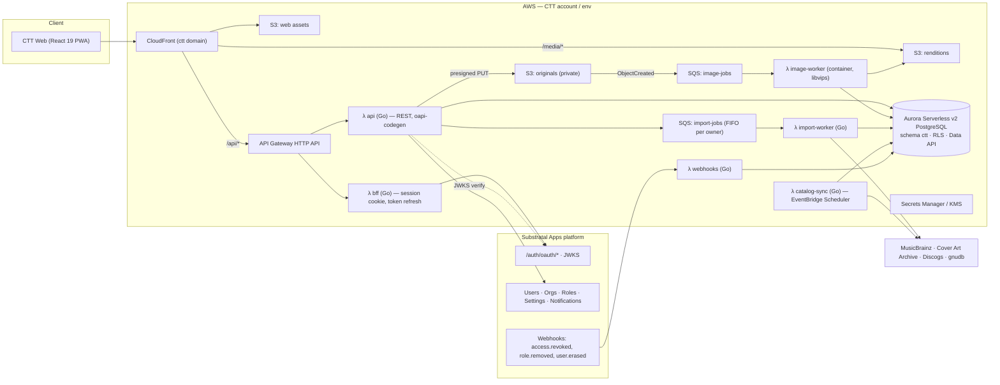

# 04 — Architecture: AWS + Substratal Apps

> Status: **Draft v0.1** · 2026-11-09 · Principle: **build CTT the way the Substratal platform builds itself**
> (Go on arm64 Lambda, Terraform, Aurora PostgreSQL via the Data API, S3 + CloudFront, no VPC/NAT at
> the starting tier) so the two share tooling, operations, and cost profile.

## 1. Division of responsibility

| Concern | Substratal Apps platform (`api.substratalapps.com`) | CTT (this repo) |
|---|---|---|
| Sign-up, login, MFA/passkeys, SSO, password reset | ✅ Hosted OAuth 2.0 + PKCE | Redirects to it; never sees passwords |
| Users, orgs/tenants, roles, permissions, entitlements | ✅ `app_ctt` registration, `app.ctt.*` permissions | Enforces permissions from token claims |
| Per-app user prefs (theme, default view, units) | ✅ `/users/{id}/apps/app_ctt/settings` (schema-validated) + AppProfile (≤16 KB JSON) | Reads/writes via API |
| Push & in-app notifications | ✅ `/applications/{id}/push-credentials`, `/users/{id}/notifications` | Emits events (loan due, want found, import done) |
| Audit, data export/erasure requests | ✅ Platform audit + erasure webhooks | Honors erasure for CTT data; provides CTT export |
| **Catalog, collections, items** | — | ✅ Own Postgres schema |
| **Images / media storage** | — (platform S3 is only avatars/app icons) | ✅ Own S3 + CloudFront + processing |
| **Search, imports, external catalog sync** | — | ✅ |
| **Billing for CTT plans** (if any) | — (platform billing covers its own plans only) | ✅ Own Stripe integration *if* CTT charges (Q4) |

## 2. System diagram



## 3. Auth & access flow

1. CTT is registered on the platform as **`app_ctt`** with permissions
   `app.ctt.collection.{read,write,delete}`, `app.ctt.catalog.{edit,moderate}`, `app.ctt.admin` and roles
   `role_ctt_collector` (default), `role_ctt_curator`, `role_ctt_admin`. (Registration scripted like
   Substratal's `scripts/register-blog.sh` → `scripts/register-ctt.sh` here.)
2. Browser → **BFF** `/api/auth/login` → redirect to Substratal hosted login (**authorization code + PKCE**).
   We use the hosted flow even though a staff-created app could use the embedded flow — it keeps CTT
   honest as a "third-party" app and gets MFA/passkeys/SSO for free.
3. BFF exchanges the code at `/auth/oauth/token`, stores the refresh token **only** in an
   `HttpOnly; Secure; SameSite=Lax` cookie (same pattern as the Substratal Hub's Go BFF), and hands the SPA
   a short-lived **app token** (5-min JWT, `aud=app_ctt`).
4. **API** verifies the JWT locally against `/.well-known/jwks.json` (cached), reads `sub`, `org_id`,
   `entitlement_status`, `effective_permissions`, then opens a DB transaction with
   `SET LOCAL ctt.sub/ctt.org` so Postgres RLS enforces ownership (defense in depth).
5. **Revocation (required by the platform):** the `webhooks` Lambda subscribes to `access.revoked` and
   `role.removed`, verifies the signature, and kills matching BFF sessions immediately. Erasure webhooks
   trigger a purge job for that `sub` (rows + S3 prefix `u/{sub}/`).
6. Server-to-server calls (e.g. sending notifications) use a Substratal **API key** scoped to `app_ctt`
   from Secrets Manager, with `Idempotency-Key` on POSTs.

## 4. Database

**Decision (Q1): Aurora Serverless v2 PostgreSQL, own `ctt` schema in the shared Substratal cluster, accessed via the RDS Data API, RLS on.**

Why Postgres fits this domain:
- The domain is **relational and graph-ish** — works → releases → media → tracks, many-to-many credits,
  relationships, events. "Every release this engineer cut, that I own, on a 1970s pressing" is a join, not a key lookup.
- Fuzzy search (`pg_trgm`) + full text (`tsvector`) cover v1 search without another service.
- `jsonb` gives schemaless format attributes (RPM, NR type, color variants) without per-format tables.
- Continuity: the legacy CTT schemas were Postgres; the Substratal platform is Postgres with RLS + Data API.
- Data API = no VPC, no NAT, no connection pooling headaches from Lambda.

| Option | Verdict |
|---|---|
| **A. `ctt` schema in the existing Substratal Aurora cluster** (like the blog engine's `blog` schema) | ✅ **Start here.** Lowest cost/ops; separate DB roles + RLS keep isolation. |
| B. Dedicated Aurora Serverless v2 cluster for CTT | Move here when CTT load or blast-radius concerns justify it. Migration is a dump/restore — same engine. |
| C. Aurora DSQL | Interesting (serverless, scale-to-zero, Postgres-compatible) but feature gaps (e.g. extensions like `pg_trgm`, foreign keys, RLS) need verification before betting on it. |
| D. DynamoDB | ✘ Poor fit for the credit/relationship graph and ad-hoc collector queries; would force a second search store early. |

Migrations: plain numbered SQL in `/db/migrations` (same style as the platform), applied by a migration
Lambda/CLI in CI. Reference data (formats, grade scale, credit roles) in `/db/seed`.

## 5. Images pipeline

```
SPA ──POST /items/{id}/images {type, side, contentType, bytes}──▶ api
api ──insert item_image(status=pending)──▶ DB
api ──presigned PUT (or multipart for >10 MB)──▶ SPA
SPA ──PUT original──▶ s3://ctt-{env}-originals/u/{sub}/i/{item}/{image}/original
S3 ObjectCreated ─▶ SQS image-jobs ─▶ λ image-worker
   • validate magic bytes & size (≤25 MB), decode HEIC/JPEG/PNG/WebP
   • auto-orient, strip EXIF/GPS
   • renditions: 200 / 600 / 1600 px × AVIF + WebP + JPEG
   • sha256 + perceptual hash (dupe hint), dominant color
   • write to s3://ctt-{env}-renditions/…, update item_image(status=ready)
SPA polls / receives SSE → shows image
```

- **Image worker:** Go + libvips (govips) packaged as an arm64 **Lambda container image** (libvips/libheif
  need native libs). Alternative: Node.js + `sharp` Lambda if the Go/libvips build is painful — decision in Q8.
- **Delivery:** CloudFront with Origin Access Control in front of the renditions bucket.
  Private collections → **CloudFront signed cookies** scoped to `/media/u/{sub}/*`, issued by the BFF.
  Public collections → cacheable public paths.
- **Originals** never served directly; available to the owner only via short-lived presigned GET (download/export).
- Lifecycle: originals to S3 Intelligent-Tiering after 30 days; failed/pending uploads expire after 24 h.
- OCR assist (v1.5): Amazon Textract or Rekognition `DetectText` on `runout_*`/`label_*` images → suggest matrix/catalog numbers.

## 6. External catalog integration

| Source | Use | Notes |
|---|---|---|
| **MusicBrainz** | Primary catalog seed & lookups; disc-ID lookup | Core data CC0. Requires meaningful `User-Agent`; ~1 req/s — all calls go through `lookup_cache` + a rate-limited worker. Consider mirroring the MB data dumps later instead of live API. |
| **Cover Art Archive** | Fallback cover images | Per-image licensing varies; store reference + attribution, cache thumbnails only as permitted. |
| **Discogs** | Search, collector-familiar release IDs, **CSV import** of user collections | API terms & rate limits apply (authenticated vs. not); **do not bulk-copy Discogs images** — link/attribute. Verify current terms before launch. |
| **gnudb (CDDB)** | CD disc-ID → title lookup (issue #4) | Community data; light use only. |

All third-party calls live in the `import-worker` / `catalog-sync` Lambdas — never in the request path.

## 7. API surface (CTT's own)

OpenAPI 3.1 at `/api/openapi.yaml` is the source of truth; Go server stubs via `oapi-codegen`, TypeScript
client types generated for the SPA (same toolchain as the Substratal Hub). Conventions copied from the
platform: no `/v1` in paths, `Ctt-Version` header, prefixed IDs, cursor pagination, RFC 9457 problem+json errors,
`Idempotency-Key` on creates.

Resource groups (v1):
`/collections`, `/collections/{id}/items`, `/items/{id}`, `/items/{id}/images`, `/items/{id}/conditions`,
`/items/{id}/plays`, `/items/{id}/loans`, `/locations`, `/crates`, `/wants`, `/tags`,
`/catalog/search`, `/catalog/releases/{id}`, `/catalog/works/{id}`, `/catalog/parties/{id}`,
`/catalog/labels/{id}`, `/catalog/events/{id}`, `/catalog/edits`,
`/identify/barcode`, `/identify/disc-id`, `/identify/text`,
`/imports`, `/imports/{id}/rows`, `/exports`, `/me/stats`,
`/public/shelves/{slug}` (unauthenticated, public collections only).

## 8. Frontend

Same stack as the Substratal Hub, styled with CTT's own brand tokens ([02](02-brand-and-design.md)):

- **TypeScript, React 19, Vite**
- **TanStack Router** (file-based routes), **TanStack Query** (server cache), **TanStack Table + Virtual** (10k-item shelves)
- **react-aria-components** for accessible primitives
- **Plain CSS + design tokens** (`/apps/web/src/styles/tokens.css`) — no Tailwind, consistent with the Hub
- **vite-plugin-pwa / Workbox**: installable, offline shelf, background-sync capture queue
- Barcode scanning: `BarcodeDetector` API with a ZXing WASM fallback
- Tests: Vitest + Testing Library, Playwright e2e (incl. visual snapshots of key brand screens)
- Hosting: S3 + CloudFront (same distribution as `/api/*` and `/media/*` → one origin, no CORS)

## 9. Repository layout (target)

```
collectorstunetracker/
├── apps/
│   └── web/                     # React 19 + Vite PWA
├── cmd/                         # Go Lambda entrypoints
│   ├── api/
│   ├── bff/
│   ├── webhooks/
│   ├── image-worker/            # container image
│   ├── import-worker/
│   ├── catalog-sync/
│   └── migrate/
├── internal/                    # Go packages: auth, catalog, collection, media, ingest, db, httpx
├── api/openapi.yaml             # CTT API contract
├── db/
│   ├── migrations/              # 0001_init.sql, 0002_catalog.sql, …
│   └── seed/                    # formats, grades, credit roles
├── infra/terraform/
│   ├── bootstrap/               # state bucket, OIDC role for GitHub Actions
│   ├── modules/                 # web, api, media, queues, db-schema, observability
│   └── envs/{dev,prod}/
├── scripts/register-ctt.sh      # registers app_ctt on Substratal
├── brand/logo/                  # existing marks (copied from collectors_tracker_docs branch)
├── docs/spec/                   # this specification
├── legacy/database/             # imported collectorstunetracker_db (history preserved), reference only
├── go.mod
└── README.md
```

## 10. Environments, CI/CD, operations

- **Envs:** `dev` and `prod` (separate AWS accounts preferred; at minimum separate state + prefixes).
- **CI/CD:** GitHub Actions with AWS OIDC (no long-lived keys): lint/test Go + web → `terraform plan` on PR →
  apply on merge to `main` (dev) / tag (prod). Replaces the stale `gradle.yml` workflow.
- **Observability:** CloudWatch Logs (structured JSON), metrics/alarms on 5xx, queue age, DLQ depth,
  image-worker failures; X-Ray tracing on API.
- **Cost guardrails:** AWS Budgets + Cost Anomaly Detection (as the platform does); Aurora min ACU at the
  lowest setting the shared cluster allows; S3 lifecycle rules; CloudFront caching for renditions.
- **Security:** S3 Block Public Access on all buckets; KMS on originals; WAF managed rules on CloudFront
  (rate limit uploads/auth); secrets only in Secrets Manager; dependency scanning in CI.
