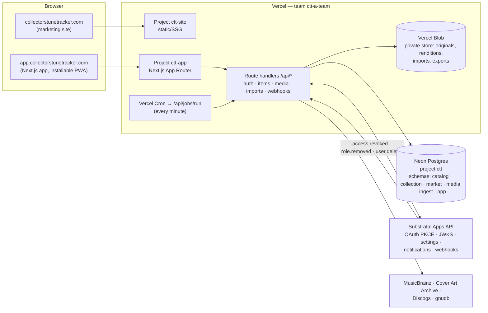

# 04 — Architecture: Vercel + Neon (+ Substratal identity)

> Status: **Draft v0.2** · 2026-11-12 · Replaces the AWS-first design, which is now
> [09 — AWS Architecture](09-aws-architecture.md), the scale-out path. Costs and the trigger points for moving pieces
> to AWS are in [08 — Hosting, Costs & Scaling](08-hosting-costs-and-scaling.md).

## 1. Principles

1. **Ship on what's already paid for.** The `ctt-a-team` Vercel team is already on Pro (commercial use allowed,
   $20/month credit, 1 TB flat-rate CDN). Neon's free plan covers the database at launch.
2. **Stay portable.** Plain PostgreSQL, a storage interface for media, and a job table for background work. Nothing in the
   domain code depends on a Vercel-only API, so any piece can move to AWS on its own ([09](09-aws-architecture.md)).
3. **CTT stays autonomous.** Its own Neon project (its own database, credentials, and backups). Substratal is used
   only through its public API, as a customer (unchanged from [`setup-on-substratal.md`](../setup-on-substratal.md)).
4. **Private by default, enforced in the data layer**, not just the UI ([03 §9](03-domain-and-data-model.md#9-tenancy-visibility--security-row-level-security)).

## 2. Who does what

| Concern | Provided by |
|---|---|
| Hosting, SSR, API routes, CDN, preview deployments, cron | **Vercel** (team `ctt-a-team`, Pro) |
| Relational data (catalog, collections, visibility, market, jobs, sessions) | **Neon** Postgres 16+, project `ctt`, connected through the Vercel Marketplace integration |
| Images, import uploads, export archives | **Vercel Blob** (private store) |
| Sign-up, sign-in, MFA, account recovery, per-user settings (theme), notifications | **Substratal Apps** (`app_collectors-tune-tracker`), public API only |
| Domain & DNS | **Vercel Domains** for `collectorstunetracker.com` (registrar move to AWS only if/when the AWS path is taken) |
| Email (message and listing notifications) | **Resend** via the Vercel Marketplace, sent from `mail.collectorstunetracker.com` |
| External catalog data | MusicBrainz, Cover Art Archive, Discogs, gnudb (rate-limited, cached) |

## 3. System diagram



## 4. Repository & projects

Turborepo + npm workspaces monorepo (no extra package manager to install). Two Vercel projects from the same repo:

```
collectorstunetracker/
├── apps/
│   ├── site/            # collectorstunetracker.com — Next.js, fully static (SSG), the zine marketing site
│   └── web/             # app.collectorstunetracker.com — Next.js App Router, the app + public pages + /api
├── packages/
│   ├── ui/              # theme tokens (from design/themes/themes.css), fonts, components, RansomTitle, XX face
│   ├── core/            # domain logic: visibility resolution, grading, import mappers, export writers (pure TS, fully tested)
│   ├── db/              # Drizzle schema, SQL migrations, seed (formats, grades, credit roles), RLS policies
│   ├── media/           # MediaStore interface + VercelBlobStore (and later S3Store), sharp pipeline
│   └── substratal/      # typed client generated from Substratal's OpenAPI, token verification, webhook verification
├── design/themes/       # theme lab (source of truth for tokens)
├── brand/logo/          # logo assets
├── docs/                # spec + runbooks
└── legacy/database/     # old DB repo, reference only
```

| Vercel project | Root | Domains | Notes |
|---|---|---|---|
| `ctt-site` | `apps/site` | `collectorstunetracker.com`, `www.` → apex | Fully static; **Log in** links to the app |
| `ctt-app` | `apps/web` | `app.collectorstunetracker.com` | Preview deployments per PR, each with its own Neon branch |

## 5. Stack

| Layer | Choice | Why |
|---|---|---|
| Framework | **Next.js (App Router, current stable), React 19, TypeScript** | First-class on Vercel; server rendering for public shelves (fast, good link previews); route handlers replace the planned Go BFF |
| UI primitives | **react-aria-components** | Accessible controls (same choice as the Substratal Hub) |
| Styling | **Plain CSS + design tokens** from `design/themes/themes.css` | Same tokens as the theme lab; no Tailwind |
| Data access | **Drizzle ORM** over the standard **`pg`** driver, using Neon's pooled connection string | Typed queries; the same driver works on local Postgres, Neon, and Aurora; migrations are plain SQL files checked into git |
| Validation | **Zod** | Shared by forms, route handlers, and importers |
| Media | **@vercel/blob** (client uploads) + **sharp** in Node functions | Direct browser → Blob uploads; renditions made server-side |
| Tests | Vitest, Testing Library, Playwright (+ axe), Postgres 16 in Docker for integration tests | Same portability check as before: everything must pass on stock Postgres |

> **Language change (revisits Q11):** the AWS plan chose Go to match Substratal's Lambdas. On Vercel, TypeScript across
> the whole repo is the better fit: one language, shared types between UI and API, and Next.js route handlers in place
> of a separate BFF. Go on Vercel is possible but would mean two toolchains for no gain. Recommendation: **TypeScript**.
> See Q11 in [06](06-open-questions.md).

## 6. Authentication (Substratal, unchanged in substance)

- `GET /api/auth/login` → redirect to Substratal's hosted authorize page (authorization code + PKCE, `client_id=app_collectors-tune-tracker`,
  `redirect_uri=https://app.collectorstunetracker.com/api/auth/callback`).
- `GET /api/auth/callback` → exchange the code at `/auth/oauth/token` → create a row in `app.session` (refresh token
  encrypted at rest with a key in Vercel environment variables) → set `ctt_session` (HttpOnly, Secure, SameSite=Lax,
  host-only on `app.`) holding only the session id.
- Server code gets a fresh 5-minute app token when needed, verifies it against Substratal's JWKS (cached), and reads
  `sub`, `org_id`, `effective_permissions`.
- `POST /api/hooks/substratal` verifies the webhook signature; on `access.revoked` / `role.removed` it deletes that
  user's sessions immediately; on `user.deleted` it queues a purge job (rows + Blob prefix).
- **Blocker unchanged:** Substratal's hosted sign-in page (`auth.substratalapps.com/authorize`) isn't live (Q16).
  Everything else can be built and tested with a local mock of the authorize/token endpoints.

## 7. Data (Neon)

- **One Neon project, `ctt`**, in the AWS region next to Vercel's functions (`us-east-1` ↔ Vercel `iad1`).
  Connected through the Vercel Marketplace Neon integration, which injects `DATABASE_URL` (pooled) and
  `DATABASE_URL_UNPOOLED` (for migrations).
- **Branches:** `main` = production; a **branch per preview deployment**, created automatically and deleted with the
  preview; `dev` for local work. Neon Free allows 10 branches per project, which is enough for a solo dev.
- **Migrations:** `packages/db/migrations/*.sql` run against `DATABASE_URL_UNPOOLED` in the Vercel build step for
  preview and production (or manually with `pnpm db:migrate`).
- **RLS:** each request's transaction sets `ctt.sub` / `ctt.org`, and policies enforce ownership (defense in depth). Runtime connections use `pg` with the pooled URL; Vercel Fluid compute reuses the pool across requests.
- **Search:** Postgres full text (`tsvector`) plus `pg_trgm`, both available on Neon.
- **Free plan limits to respect:** 1 GB storage, 100 CU-hours/month (scales to zero after 5 minutes idle), 5 GB egress,
  6 hours of point-in-time history. Mitigations: lazy catalog (no MusicBrainz mirror), nightly logical backup (`pg_dump` to private
  Blob, kept 30 days), and usage alerts. Upgrade to Neon Launch (pay-as-you-go) when any limit gets to 70%.

## 8. Images & files (Vercel Blob)

| Path in the private store | What |
|---|---|
| `u/{sub}/i/{itemId}/{imageId}/original` | Upload, EXIF/GPS stripped and re-encoded (max 3000 px long edge) |
| `u/{sub}/i/{itemId}/{imageId}/{thumb\|card\|detail}.{avif\|webp\|jpg}` | Renditions at 200 / 600 / 1600 px |
| `u/{sub}/imports/{jobId}/source.*` | Import uploads (deleted 30 days after the job finishes) |
| `u/{sub}/exports/{jobId}.zip` | Export archives (deleted after 7 days) |
| `backups/db/{date}.sql.gz` | Nightly database dumps (30-day retention) |

- **Upload:** `POST /api/items/{id}/images` checks ownership and limits (25 MB, image types, per-user quota) and returns a
  client-upload token. The browser uploads straight to Blob. Blob's `onUploadCompleted` callback inserts an `image_job`.
- **Processing:** the job worker (§9) runs **sharp**: validate, auto-orient, strip metadata, re-encode the original,
  make the renditions, compute the dominant color and perceptual hash, and mark the image `ready`.
- **Delivery:** every image is served through `GET /media/{imageId}/{variant}`, which checks the image's effective
  visibility:
  - **public:** streamed with `Cache-Control: public, s-maxage=31536000, immutable` and a cache tag for that item, so the
    CDN serves repeats without touching the function;
  - **unlisted:** the token is required, and the response is cached only per token URL;
  - **private:** requires the owner's session and is sent with `Cache-Control: private, no-store`.
  - When an item becomes less visible, CTT purges its cache tag **before** answering the request that changed it.
- **Later optimization:** move public renditions to a separate public Blob store (cheaper, direct-to-browser delivery),
  or to S3 + CloudFront if image traffic dominates ([08 §4](08-hosting-costs-and-scaling.md)).

## 9. Background work

No queue service at launch. Jobs are rows in `app.job` (`type`, `payload`, `run_after`, `attempts`, `locked_until`, `status`):

- Enqueued in the same transaction as the change that needs them (outbox pattern).
- Kicked off right away with Next.js `after()` so most jobs finish within seconds.
- **Vercel Cron** calls `/api/jobs/run` every minute as a safety net. It claims jobs with `FOR UPDATE SKIP LOCKED`, runs them
  within the function's time limit, and retries with backoff; after 5 failures a job is marked dead and shows up in admin.
- Job types: `image.process`, `import.batch`, `export.build`, `purge.user`, `catalog.lookup`, `notify.send`,
  `listing.expire`, `backup.db`.
- The same table can be drained by an SQS consumer on the AWS path; job handlers don't know who called them.

## 10. Public pages, visibility & caching

- Public and unlisted routes (`/@handle`, `/@handle/c/{collection}`, `…/g/{group}`, `/i/{item}`, `/crates/{id}`,
  `/market`, `/market/{listing}`) are server-rendered from the **public read model** (`public_item_v`, listing snapshots).
  They never touch private columns.
- They're cached with ISR and cache tags (`collector:{sub}`, `collection:{id}`, `item:{id}`, `listing:{id}`). Any
  write that changes visibility or public content revalidates the affected tags. Making something *less* visible
  revalidates synchronously, before the response.
- `robots` meta tags and the sitemap include only collectors who opted into search indexing.
- Each public page embeds schema.org JSON-LD ([07 §1](07-import-export.md#1-is-there-a-standard-format)) and an
  Open Graph image generated from the cover art.

## 11. Theme selection (implementation)

Per [02 §3.7](02-brand-and-design.md#37-the-theme-system):
- Settings live in Substratal per-app settings (`theme_mode`, `theme_light`, `theme_dark`), cached in the `ctt_theme`
  cookie (`mode|light|dark`, e.g. `system|cream-sleeve|back-room`).
- The root layout reads the cookie. For `light`/`dark` it sets `<html data-theme>` on the server. For `system`
  it emits both theme ids as `data-theme-light`/`data-theme-dark` attributes plus a few-line inline script that picks one
  before first paint and listens for `prefers-color-scheme` changes.
- Settings → Appearance updates the cookie and the page instantly (optimistic), then saves to Substratal.
- Themes load from one CSS file (all ten themes are about 6 KB gzipped), so switching never triggers a network request.

## 12. Environments & configuration

| Env | Where | Database | Blob | Substratal app |
|---|---|---|---|---|
| Local | `pnpm dev` | Docker Postgres 16 (or the Neon `dev` branch) | Blob dev store, or a local filesystem `MediaStore` | local auth mock |
| Preview | Vercel preview per PR | Neon branch per preview | Blob preview store | local auth mock (preview URLs change, so they can't be redirect URIs) |
| Production | Vercel production (`main`) | Neon `main` | Blob production store | `app_collectors-tune-tracker` |

Secrets live in Vercel environment variables (`vercel env pull` for local): `DATABASE_URL*`, `BLOB_READ_WRITE_TOKEN`,
`SUBSTRATAL_API_KEY`, `SUBSTRATAL_WEBHOOK_SECRET`, `SESSION_ENCRYPTION_KEY`, `CRON_SECRET`.

## 13. Operations

- **Spend management** on the Vercel team (alert at $50 and $100 over the base fee; pause if runaway), Neon usage
  alerts, and Blob usage dashboards.
- **Observability:** Vercel logs and Observability; structured JSON logs from route handlers; a `/api/health` check.
- **Backups:** Neon point-in-time history (6 h on Free, 7 days on Launch) plus nightly `pg_dump` to Blob.
- **Security:** CSP and security headers, CSRF protection on mutations (SameSite plus an origin check), rate limits on auth,
  uploads, messages, and listings (Postgres token bucket at first; Vercel Firewall rules for abuse).
